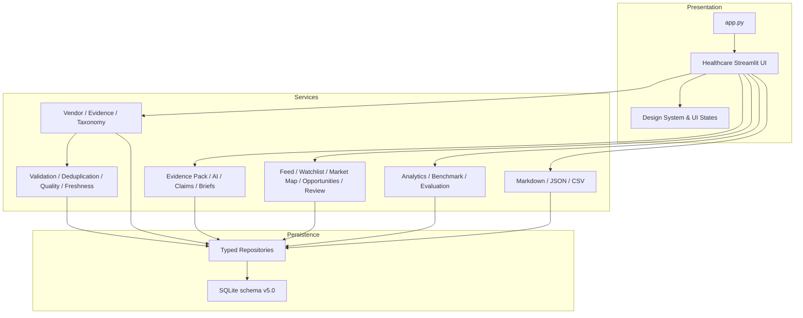

# Architecture

## System boundary

This repository is a local, synthetic-evaluation portfolio product. Streamlit is the presentation layer, SQLite is the persistent source of truth, and business rules are implemented in Python services. Optional OpenAI generation never bypasses Evidence selection, structured parsing, Claim classification, or traceability validation.

## Request lifecycle

1. `app.py` resolves the optional database path and starts the healthcare UI.
2. `bootstrap_product_workflow` initializes schema migrations and dependency wiring.
3. Idempotent seed services load synthetic Demo data when required.
4. The selected Streamlit workspace calls service-layer methods.
5. Services enforce validation, identity, eligibility, workflow, and audit rules.
6. Repositories read or persist typed domain objects in SQLite.
7. The UI renders reconciled state and never invents KPI values.

Only the active primary workspace is rendered. This avoids executing the former 13 page bodies on every Streamlit rerun.

## Evidence-to-decision workflow

## Main modules

| Module | Responsibility |
|---|---|
| `src/healthcare/database.py` | Additive schema initialization and migration |
| `src/healthcare/models.py` | Vendor, Evidence, and foundation entities |
| `src/healthcare/intelligence_models.py` | Evidence Pack, Claim, Brief, profile, and generation entities |
| `src/healthcare/workflow_models.py` | Feed, Watchlist, Opportunity, review, derived-output, usage, and audit entities |
| `src/healthcare/analytics_models.py` | Benchmark and metric definitions |
| `src/healthcare/repositories.py` | Foundation persistence |
| `src/healthcare/intelligence_repositories.py` | Intelligence persistence |
| `src/healthcare/workflow_repositories.py` | Operational workflow persistence |
| `src/healthcare/analytics_repositories.py` | Benchmark persistence |
| `src/healthcare/services.py` | Vendor and Evidence application rules |
| `src/healthcare/intelligence_services.py` | Vendor intelligence, comparisons, and Brief generation |
| `src/healthcare/traceability_service.py` | Evidence-Pack-scoped citation and Claim validation |
| `src/healthcare/workflow_services.py` | Monitoring, market, opportunity, review, derived outputs, usage, and audit |
| `src/healthcare/analytics_service.py` | Single metric source and Benchmark eligibility |
| `src/healthcare/intelligence_export.py` | Stored Brief export without regeneration |
| `src/healthcare/ui.py` | Page composition and interaction orchestration |
| `src/healthcare/ui_components.py` | Phase 6 tokens, cards, badges, and UI states |

## AI boundary

`AIService` is a replaceable generation adapter. Its output must conform to the structured Brief schema. `EvidencePackService`, `ClaimService`, and `TraceabilityService` remain authoritative for eligible Evidence, citation identity, and support state.

Without `OPENAI_API_KEY`, deterministic generation produces reviewable synthetic-demo output with stored Evidence IDs. This path exists for reproducibility and portfolio demonstration; it is not presented as real market research.

## Metric boundary

`AnalyticsService.snapshot()` is the only source used by the Analytics UI and evaluation exports. Benchmark KPIs require complete comparable Manual/AI pairs and a minimum valid sample. DRAFT, unpaired, and non-comparable observations cannot enter efficiency KPIs.

## Component status

| Status | Components |
|---|---|
| Active | `app.py`, `src/healthcare/`, `scripts/`, healthcare tests, taxonomy, Demo data, SQLite database, Phase 2–6 documentation |
| Legacy adapter | `collector.py`, `brief_generator.py`, `config/competitors.json`, `legacy/app_store_adapter.py`, original collector/brief tests |
| Deprecated | None currently declared |

Legacy consumer-app adapters are isolated and are not imported by the healthcare Streamlit application. They are retained for compatibility and audit history.

## Security and privacy

- Secrets are read from environment variables or Streamlit secrets and are not displayed.
- `.env` and `.streamlit/secrets.toml` are ignored.
- The repository contains no private hospital, patient, client, or production data.
- Source URLs are opened explicitly by the user; imported Evidence is validated before use.
- Debug detail is hidden behind an expander when a UI error occurs.

## Deployment boundary

The release target is a **Public Portfolio Release**, not “Production Ready.” A production deployment would still require authentication, authorization, managed secrets, a production database, observability, backup/recovery, compliance review, data-source agreements, and operational ownership.
