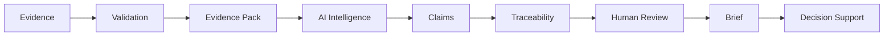
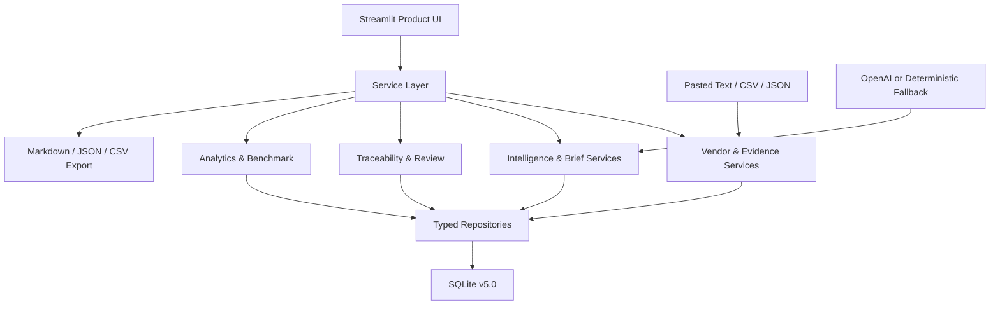

# AI-Powered Healthcare Market Intelligence Agent

> Portfolio Release Candidate `1.0.0-rc1`

An evidence-grounded competitor intelligence workspace designed for healthcare IT marketing, market intelligence, and sales enablement workflows.

All bundled Vendor, hospital, procurement, and market records are **synthetic evaluation data**. This repository is an enterprise-style portfolio implementation—not a production deployment and not evidence of use by a healthcare organization.

## Overview

The product turns structured healthcare IT Evidence into reviewable intelligence outputs. It combines deterministic Evidence selection, optional AI generation, Claim-level citation validation, human review, and export in one Streamlit workflow.

The default Demo Mode runs without an API key. When an OpenAI API key is configured, model output still passes through the same Evidence Pack, structured-output, support-classification, and traceability controls.

## Business Problem

Healthcare IT marketing and sales teams often need to monitor many Vendors, source types, solution categories, case studies, and procurement signals. Manual research creates three recurring risks:

- source material and business conclusions become disconnected;
- facts, analytical inference, and recommendations are mixed together;
- Briefs are difficult to review, reproduce, and reuse across marketing, management, and sales.

## Solution

This product provides a persistent Vendor and Evidence foundation, an operational monitoring workspace, evidence-grounded intelligence generation, Claim-to-Evidence traceability, human review, and decision-ready outputs.

It is designed around a strict separation:

- `FACT` — requires eligible Evidence from the originating Evidence Pack;
- `INFERENCE` — an interpretation with an explicit Evidence basis;
- `RECOMMENDATION` — decision support, never presented as a verified market fact.

Claims are also classified as `SUPPORTED`, `PARTIALLY_SUPPORTED`, or `UNSUPPORTED`.

## Key Capabilities

- Healthcare IT Vendor Library and evidence-backed Vendor profiles
- Evidence Library with validation, deduplication, authority, quality, and freshness
- Intelligence Feed and Vendor Watchlist
- Vendor × Solution Category Market Map
- Structured comparison of 2–5 Vendors
- Evidence-based Opportunity Finder
- Competitor, Executive, and Sales Enablement Briefs
- Claim and Brief review workflows
- Claim → Evidence Pack → source traceability
- Markdown, structured JSON, and Claim CSV export
- SQLite persistence, usage logging, and audit trail
- Analytics and an honest paired-workflow Benchmark workspace
- Deterministic Demo Mode with no API key required
- GitHub Actions validation

## Product Workflow



## Screens / Modules

The final information architecture uses nine primary workspaces:

| Workspace | Purpose |
|---|---|
| Overview | Command center for monitored scope, recent changes, watchlist, quality, and required action |
| Intelligence | Compact Feed and priority Vendor Watchlist |
| Vendors | Searchable Vendor library, profile detail, Evidence timeline, and intelligence generation |
| Evidence | Search, filters, validation/quality detail, related Claims, and import |
| Market | Market Map, structured Vendor comparison, and evidence-based opportunities |
| Briefs | Competitor, Executive, and Sales Enablement output libraries |
| Review | Focused Brief, Claim, and Evidence work queues |
| Analytics | Coverage, quality, output, workflow, and Benchmark evaluation |
| Settings | Runtime/data mode, rule reference, and system health |

See [PORTFOLIO_SCREENSHOT_GUIDE.md](PORTFOLIO_SCREENSHOT_GUIDE.md) for the eight recommended portfolio views.

## Architecture



Business rules live in services, not Streamlit. Repositories own persistence; the UI orchestrates user intent and presents state. See [ARCHITECTURE.md](ARCHITECTURE.md) and [DATA_MODEL.md](DATA_MODEL.md).

## Data Model

The additive SQLite schema stores:

- Vendors, Solution Categories, and Evidence
- Evidence Packs, Claims, Briefs, Vendor Profiles, and generation logs
- Feed events, Watchlist entries, Opportunities, and duplicate groups
- Brief reviews, review notes, saved comparisons, Executive Briefs, and Sales outputs
- Usage events, audit events, schema metadata, and Benchmark runs

The current schema version is `5.0`. IDs, references, taxonomy values, hashes, dates, statuses, duplicate links, citation scope, and Vendor metrics are checked by `scripts/check_data_integrity.py`.

## Claim Traceability

Every generated Brief points to one reproducible Evidence Pack. Every Claim stores its Claim type, Evidence IDs, support level, traceability state, and review status.

A citation is valid only when the Evidence ID:

1. exists in SQLite;
2. belongs to the Brief's originating Evidence Pack;
3. is eligible under the Evidence selection rules.

Unknown, missing, or out-of-Pack citations are rejected. See [TRACEABILITY_SPEC.md](TRACEABILITY_SPEC.md).

## Healthcare Evidence Model

Evidence is organized around a healthcare IT taxonomy and source model rather than consumer-app metrics. Supported source types include Vendor solution pages, company announcements, hospital case studies, public procurement, tender announcements, government sources, and industry reports.

Evidence Quality is a transparent maintenance score:

```text
Source Authority  0–3
Recency           0–3
Completeness      0–2
Traceability      0–1
Relevance         0–1
Total             0–10

HIGH >= 8 · MEDIUM >= 5 · LOW < 5
```

Freshness is `FRESH` at 0–90 days, `AGING` at 91–180 days, and `OUTDATED` above 180 days. These are internal intelligence-maintenance rules, not healthcare industry standards.

## Demo Mode

Demo Mode automatically loads a deterministic synthetic healthcare IT dataset and supports the core workflow without `OPENAI_API_KEY`:

1. Explore monitored Vendors.
2. Open a Vendor profile and its Evidence timeline.
3. Inspect the Market Map or compare Vendors.
4. Review Claim-level citations.
5. Export a structured Brief.

The UI persistently labels the environment `DEMO MODE · Synthetic Evaluation Data`. Synthetic provenance also propagates to Evidence, Briefs, Feed events, Opportunities, derived outputs, usage, and audit records.

## Evaluation Results

Current SQLite snapshot:

| Metric | Result | Scope |
|---|---:|---|
| Active Vendors | 12 | Synthetic evaluation Vendors |
| Evidence Records | 183 | Includes retained duplicate and warning records |
| Validated Evidence | 171 | `Validated` + `Valid` |
| Competitor Briefs | 12 | Structured stored Briefs |
| Claims | 120 | All support and review states |
| Invalid Citations | 0 | Current structured citation validation |

The reviewed traceability sample is small: 7 of 8 manually reviewed Claims are traceable. It is reported as an evaluation detail, not a broad production-quality claim.

The real paired human Benchmark is not complete. Therefore the following remain `NOT AVAILABLE` and must not be presented as achieved KPIs:

- Manual Median
- AI-Assisted Median
- Time Reduction
- Speed Multiple

See [EVALUATION_REPORT.md](EVALUATION_REPORT.md), [METRIC_AUDIT.md](METRIC_AUDIT.md), and [CV_EVIDENCE.md](CV_EVIDENCE.md).

## Tech Stack

- Python 3.12+ (CI: Python 3.12)
- Streamlit 1.40+
- SQLite
- pandas
- OpenAI Python SDK (optional generation path)
- `unittest` and Streamlit AppTest
- GitHub Actions

## Setup

```powershell
python -m venv .venv
.\.venv\Scripts\Activate.ps1
python -m pip install --upgrade pip
python -m pip install -r requirements.txt
```

The app reads environment variables directly. `.env.example` is a configuration reference; load values through your shell, IDE, or Streamlit secrets. Do not commit `.env` or `.streamlit/secrets.toml`.

## Environment Variables

| Variable | Required | Purpose |
|---|---|---|
| `OPENAI_API_KEY` | No | Enables OpenAI generation; Demo Mode uses deterministic output when absent |
| `OPENAI_MODEL` | No | Optional model override; default `gpt-5.6` |
| `HEALTHCARE_DATABASE_PATH` | No | Optional SQLite path override |

PowerShell example:

```powershell
$env:OPENAI_API_KEY="your-key"
$env:OPENAI_MODEL="gpt-5.6"
```

## Running Locally

```powershell
streamlit run app.py
```

Open `http://localhost:8501`. The bundled demo database is created and seeded idempotently on first run.

To rebuild the complete deterministic evaluation snapshot:

```powershell
python scripts/seed_demo_data.py --reset
python scripts/seed_phase3_demo.py
python scripts/seed_phase4_demo.py
python scripts/run_evaluation.py
python scripts/export_cv_metrics.py
python scripts/validate_cv_metrics.py
python scripts/check_data_integrity.py
```

`scripts/run_evaluation.py` measures automated stages and saves DRAFT AI rows. It does not fabricate manual research, human review, or editing time.

## Testing

```powershell
python -m unittest discover -s tests -v
python scripts/check_data_integrity.py
```

The suite covers unit, integration, product workflow, traceability, export, Analytics, Benchmark, Demo Mode, no-API-key operation, and all primary Streamlit workspaces.

## Export

Each stored Competitor Brief can be exported as:

- Markdown for readable handoff;
- structured JSON for downstream systems;
- CSV for Claim-level review and analysis.

Exports reuse the stored Brief and Evidence identities; they do not rerun generation.

## Limitations

- Synthetic evaluation dataset only
- No production client data
- No private hospital data or sensitive medical data
- No claim of deployment at any healthcare organization
- No automated full-web crawling
- No CRM, authentication, or role-based access control
- SQLite and local Streamlit deployment are portfolio-scale choices
- Model output still requires human review before decision use
- Manual efficiency Benchmark not completed
- Portfolio screenshots should be captured from the deterministic Demo state using the included guide

## Future Roadmap

Phase 6 follows `POLISH > EXPAND`; new core features were not added. Deferred ideas are documented in [FUTURE_ROADMAP.md](FUTURE_ROADMAP.md).

## Portfolio Context

This project demonstrates product thinking, healthcare business-context modeling, data design, evidence-grounded AI, human-in-the-loop workflow design, analytical measurement, honest evaluation, UI productisation, and release discipline.

For the recruiter-facing narrative, demo script, role-based critique, and evidence-safe CV language, see [PORTFOLIO_GUIDE.md](PORTFOLIO_GUIDE.md).
